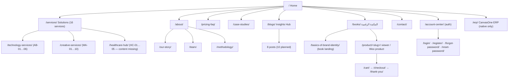

# codeandcanvas.net — site map & rebuild blueprint

Snapshot of the live WordPress site taken on **2026-10-14**, used as the source of truth for rebuilding it natively in this repository. Everything below was collected from the public pages, the WP REST API (`/wp-json/wp/v2/*`, `/wp-json/wc/store/v1/*`) and `robots.txt`. Nothing was changed on the live site.

Machine-readable version: [`docs/sitemap.json`](./sitemap.json).

---

## 1. Live site at a glance

| | |
| --- | --- |
| Platform | WordPress + Elementor Pro (templates `elementor_header_footer`, `elementor_canvas`), Astra theme |
| Commerce | WooCommerce (+ Memberships, POS) — currency **SAR** |
| Auth | Custom `cc-auth/v1` REST namespace: email/password, "Continue with Google" (`/?cc_google=start`), 6-digit 2FA / recovery codes, password reset tokens |
| Forms | Fluent Forms, WPForms, Forminator all installed (contact form + "Freelancer" conversational form) |
| SEO | AIOSEO — `/sitemap.xml` returns **HTTP 500**; `robots.txt` points to `sitemap-1.xml … sitemap-5.xml` which all **404**. The map below is built from the REST API instead. |
| Site name / tagline | "Code & Canvas" / "Where creativity meets technology" |
| Front page | page 439 (`home-nature-v2`) |
| Inventory | 26 published pages · 8 posts · 7 products · 1 category in use (`blog`) |
| Languages | Mostly English; `/books/`, `/basics-of-brand-identity/`, `/thank-you/`, the book viewer and the case-study bodies are Arabic. No language switcher, no `hreflang`. |

---

## 2. URL inventory

Legend — **Live**: public page · **Dup**: duplicate of another page · **Redir**: redirects · **Auth**: login required · **404**: linked from the site but missing.
"Native" column = state in this repository (`done` = already rebuilt, `P1/P2/P3` = planned phase, see §6).

### 2.1 Marketing pages

| # | Live URL | WP id · template | HTML `<title>` | State | Native |
| --- | --- | --- | --- | --- | --- |
| 1 | `/` | 439 · header_footer | Home - Code & Canvas | Live | **done** (`index.html`) |
| 2 | `/services/` | 26 · header_footer | Solutions - Code & Canvas | Live | P1 |
| 3 | `/technology-services/` | 5469 · default | Technology services - Code & Canvas | Live | P1 |
| 4 | `/creative-services/` | 5464 · header_footer | Creative services - Code & Canvas | Live | P1 |
| 5 | `/healthcare-hub/` | 6185 · header_footer | Healthcare Hub - Code & Canvas | Live — **body is a copy of Creative Services** (wrong content) | P1 (decide: real healthcare page or redirect) |
| 6 | `/about/` | 5437 · header_footer | About - Code & Canvas | Live | P1 |
| 7 | `/our-story/` | 5554 · header_footer | Our Story - Code & Canvas | Live (image placeholders) | P1 |
| 8 | `/methodology/` | 6187 · header_footer | Methodology - Code & Canvas | Live | P1 |
| 9 | `/team/` | 5353 · default | Team - Code & Canvas | Live | P1 |
| 10 | `/our-team/` | 6218 · default | our Team - Code & Canvas | Dup of `/team/` (all social links are `#`) | redirect → `/team/` |
| 11 | `/elementor-6205/` | 6205 · header_footer | Team - Code & Canvas | Dup of `/team/` (published Elementor draft) | redirect → `/team/` |
| 12 | `/contact/` | 5443 · default | Contact - Code & Canvas | Live | P1 |
| 13 | `/pricing-faq/` | 16 · default | Pricing & FAQ - Code & Canvas | Live | P1 |
| 14 | `/case-studies/` | 5679 · default | Our Work — Case Studies & Delivered Projects · Code & Canvas | Live (screenshots "coming soon") | P1 |
| 15 | 404 page | theme | Page not found – Code & Canvas | "404 — Lost in the void" + Return home / Send a signal | P1 (`404.html`) |

### 2.2 Content (blog)

| # | Live URL | WP id | State | Native |
| --- | --- | --- | --- | --- |
| 16 | `/blogs/` | 5525 · default | Live — "The Insights Hub", 10 cards, **5 card links 404** (see §4.2) | P2 (`/blog/`) |
| 17 | `/category/blog/` | category 1 | Live — plain Astra archive of the 8 posts | redirect → `/blog/` |
| 18 | `/why-startups-waste-money-wrong-product/` | 5563 | Live · Product Strategy · 8 min | P2 |
| 19 | `/how-to-turn-a-business-idea-into-a-market-ready-digital-product/` | 5568 | Live · "From Idea to Market-Ready Product: The 6-Step Strategic Framework" · 7 min | P2 |
| 20 | `/why-software-development-alone-wont-solve-your-business-problems/` | 5583 | Live · 8 min | P2 |
| 21 | `/what-digital-transformation-actually-means-for-smes/` | 5585 | Live · "…for SMEs in 2026" · 9 min | P2 |
| 22 | `/how-product-thinking-creates-sustainable-business-growth/` | 5586 | Live · "Product Thinking: The Framework That Turns Features Into Business Outcomes" · 6 min | P2 |
| 23 | `/why-most-brands-look-different-but-feel-the-same/` | 5637 | Live · Brand Strategy · 10 min · Mustafa | P2 |
| 24 | `/from-brand-identity-to-brand-systems/` | 5639 | Live — WP title "… – Copy"; **body is "Design Systems: The Operating System of Modern Digital Products"** (5 min) | P2 (re-slug) |
| 25 | `/creative-strategy-in-the-age-of-generative-ai/` | 5652 | Live — WP title "… – Copy"; **body is "Experience Design as a Business Growth Driver"** (5 min) | P2 (re-slug) |

Posts are dated June 2026, category `blog` only. 22 other categories exist with 0 posts and are spam leftovers (`1win-brasil`, `casino`, `mostbet-russia`, …) — do not carry them over.

### 2.3 Books & commerce (WooCommerce)

| # | Live URL | WP id | State | Native |
| --- | --- | --- | --- | --- |
| 26 | `/books/` | 5695 · default | Live — Arabic "المكتبة الرقمية", 4 books, filter tabs, add-to-cart | P2 (catalogue) / P3 (cart) |
| 27 | `/shop/` | 1468 | **Redir → `/books/`** | redirect |
| 28 | `/basics-of-brand-identity/` | 5701 · default | Live — Arabic landing page for the "Basics of Visual Identity" book (16 chapters / 3 journeys, expandable) | P2 (`/books/basics-of-visual-identity/`) |
| 29 | `/product/marketing-fundamentals/` | product 6138 · 249 SAR | Live — custom **slide viewer** (258 slides, 15 parts, ←/→, F fullscreen, speaker notes). `/books/marketing-fundamentals` redirects here. | P3 (needs auth/purchase gate) |
| 30 | `/product/basics-of-visual-identity/` | product 6126 · 199 SAR | Live — **default Woo template** (placeholder image, "Uncategorized", reviews) | P3 |
| 31 | `/product/basics-of-graphic-design/` | product 6122 · 199 SAR | Live (not inspected, same template expected) | P3 |
| 32 | `/product/دليل-تجربة-وواجهة-المستخدم/` | product 6139 · 299 SAR | Live — "UI/UX Handbook", shown as **قريباً** on `/books/` | P3 |
| 33 | `/product/full-brand-identity/` | product 1715 · 500 SAR · cat. Design Services | Live — legacy 2024 product page (66 projects / 4 awards / 2 years / 20 clients + image) | drop or redirect → `/creative-services/` |
| 34 | `/product/it-solutions/` · `/product/data-analysis/` | 2645 · 2512 · 0 SAR, not purchasable | Live but **empty** | drop |
| 35 | `/product-category/design-services/` · `/product-category/uncategorized/` | taxonomies | Live Woo archives | drop |
| 36 | `/cart/` | 2194 · canvas | Live — "Your cart is currently empty → Return to shop" | P3 |
| 37 | `/checkout/` | 2412 · canvas | Redir → `/cart/` when empty | P3 |
| 38 | `/thank-you/` | 6158 · canvas | Live — Arabic order confirmation: summary (#, date, email, payment, totals), 3 next steps (email → review ≤24h → kickoff 48–72h), links to Account Center / Books / Services / Home, WhatsApp KSA + EG | P3 |

### 2.4 Account / auth

| # | Live URL | WP id | State | Native |
| --- | --- | --- | --- | --- |
| 39 | `/login/` | 6060 · header_footer | Live — standalone layout (White-Icon.svg logo): email, password, remember me, forgot link, Google, 2FA step | P3 |
| 40 | `/register/` | 6061 | Live — full name, email, phone (optional), password ×2, Google | P3 |
| 41 | `/forgot-password/` | 6062 | Live — email → reset link | P3 |
| 42 | `/reset-password/` | 6063 | Live — token page ("Link expired" without token) | P3 |
| 43 | `/account-center/` | 5970 · header_footer | **Auth** → `/login/?redirect_to=…` (content not visible; linked from thank-you and book viewer as "حسابي") | P3 |

### 2.5 Linked but missing (404 on live)

| URL | Linked from |
| --- | --- |
| `/solutions` | Our Story "Explore All Services →", blog CTAs "Explore Services" |
| `/privacy-policy/` · `/terms-of-use/` · `/cookie-policy/` | footer of the native `index.html` in this repo (no WP page exists) |
| `/strategic-branding-differentiation-vs-visual-identity/` · `/brand-identity-to-brand-systems/` · `/design-systems-operating-system-modern-digital-products/` · `/creative-strategy-generative-ai-age/` · `/experience-design-business-growth-driver/` | `/blogs/` article cards 06–10 |
| `/sitemap.xml` (500) · `/sitemap-1.xml … 5.xml` | `robots.txt` |

### 2.6 Native-only route

| URL | State |
| --- | --- |
| `/erp/` | CanvasOne ERP interactive proposal — exists only in this repo (`erp/index.html`), not on the live site |

---

## 3. Site tree

Primary header navigation on the live site is an Elementor template that is not exposed through the API (menus return 401). Judging by the internal cross-links, the primary items are **Home · Solutions (/services/) · Our Story · About · Team · Case Studies · Books · Blogs · Contact**, plus Login / Account. Confirm against the live header before building the native nav. The native `index.html` currently uses: Solutions · CanvasOne ERP · Why us · Our approach · Contact · Let's talk.

---

## 4. Page blueprints (sections to rebuild)

Each list is in page order; counts and copy are what is live today.

### 4.1 `/` Home — already native
Hero (MENA · Brand · Technology · Transformation · Data; "Business Development By Design"; BD core discipline; 4 pillars; CTAs: our Profile → `/our-story`, Our Services → `/services/`, Learn more `#learn`) → value statement + CTAs (Book a Free Discovery Call `#book`, Explore Services `#services`) → stats (10+ years · 40+ brands · 12+ sectors · 6 productized services) → 3 featured cards (HIS Selection Advisory $2.5K · EA Quick-Start $1K · Digital Launch Package ⭐ $3.5K) → "Industry Solutions" → Our Services intro (Product Strategy · Behavioral Design · Advanced Engineering · Business Intelligence) → 15 service cards S01–S10 + HC01–HC05 (rendered twice on live, desktop/mobile) → "Customize your own package" → `/our-story` → Why Code & Canvas: Order Takers → Solution Makers, 4 pillars (Mindset · Risk · Speed 4–7× · Team) → "Where Cteativity meets Technology" (typo on live) → Begin Your Engagement: 3 cards (Free discovery call → `/contact`; Service catalog "9 Services" → `#services`; WhatsApp KSA) → Healthcare organizations block (Book Healthcare Discovery Call → `/contact`) → trust strip (clear scope · milestone payment · we'll tell you if not a match · KSA + Egypt).

### 4.2 `/services/` Solutions
Page-title band ("Solutions", star background `b8161ee4-soft-starwhite-.png`) → hero "All our solutions. Creative. Technical." (16 productized services) → stats (16 · 7+ · 20+ · KSA+EG) → **Ahmed Bedeer** card (Al Khobar; CPHIMS TOGAF EMRAM NORA; Portfolio ↗) → Technology services list **AB-01 → AB-06** (name, tag, blurb, price, duration, →) → **Mustafa Aboalazm** card (Al Obour; Brand Strategy · 7+ Years · 20+ Brands · AR + EN; Portfolio ↗) → Creative services list **MA-01 → MA-10** → "Not sure which service fits?" CTAs (Book a Free 30-Min Call → `/contact`, WhatsApp KSA (Tech), WhatsApp EG (Creative)) → **Freelancer / Career conversational form** (Name, Live in?, Email, Skill Spark, Chapters of Growth, Portfolio URL, CV URL, Daily free time: Daytime/Nighttime, Your Different Ink, Note) → footer CTA "The Home of Business Development" → `/our-story`.

Note: there is no healthcare section on this page even though the homepage and footer link to `/services/#healthcare`.

### 4.3 `/technology-services/`
Title band + breadcrumb (Home › Solutions › Technology Services) → hero "Architecting digital transformation." (6 services, one practice) → stats (7+ years KSA & MENA · 3 frameworks · 85% HIMSS Stage 6 readiness · 12+ standards) → Ahmed bio card (10 skill tags; Portfolio, Book a Call) → **credentials** ×4 (CPHIMS, EMRAM, TOGAF, NORA) → **outcomes** ×4 (12% ICU LOS · 25% faster close · 40% less admin · $500K+ savings) → services with filter (All · EA & Strategy · Healthcare · Data · Solution Arch · Cloud · Advisory): featured AB-01 (tags, "What's included" ×7, $1,000–2,500 · 2 weeks, extended $3,000–8,000 · 4–8 weeks) + AB-02…06 cards (tech tags) → **9 capabilities** (EA, DX, HC, INT, DATA, DEV, CLOUD, SEC, PMO) → engagement model ×3 (Architecture Views · Executive One-Pagers · Walkthroughs) → CTA "Have a transformation to architect?" (Book a Discovery Call, View Portfolio) + trust strip → footer CTA "Can't Wait To Hear From You" (Book an Appointment → `/about#book`, get Started → `/contact`, Full Services → `/services`).

### 4.4 `/creative-services/` (and the identical `/healthcare-hub/`)
Title band + breadcrumb (Home › Solutions › Creative Studio) → hero "Identity built as an operating system." (10 creative services) → stats (7+ · 20+ · 6 · $170) → Mustafa bio card (8 tags; Portfolio, Behance ↗, WhatsApp ↗) → **4-act method** (Discovery & Research d1–6 · Brand Strategy d5–9 · Concept & Design d9–27 · Refine & Deliver d27–38; avg. 38 days) → services with filter (All 10 · Brand Identity 4 · Web & Digital 2 · Print & Production 2 · Media & Retainers 3): featured MA-03 Full Brand System (tags, "What's included" ×8, $1,490–2,975+ · 5–7 weeks · 50/25/25) + MA-01, 02, 04…10 cards → **À la carte** price list ×8 (Business Card $22 · Brochure $34 · Flyer $26–38 · Poster $26–43 · Roll-Up $30 · Social Post $11 · Pack ×10 $85 · Landing Page $170–340; "Full pricing list ↗" → aboalazm-os.vercel.app) → "Have a brand to shape?" (WhatsApp EG, Send a Brief → `/contact`) + policy strip (10% off prepayment · files after final payment · 2 revision rounds · AR & EN · Al Obour · Remote) → footer CTA.

### 4.5 `/about/`
Title band → hero "We build what businesses need to grow — by design." + 3 CTAs (Book a Discovery Call, Our Story, Meet the Team) → stats (7+ · 20+ · 6 · 14 · 2 countries) → "Studio · At a Glance" panel (Technology Track · Creative Track · Combined · Serving) → Why ×6 (Productized · BD logic · Dual expertise · Healthcare depth · MENA-native · Milestone payment) → **Two tracks**: Ahmed (6 credentials, bio, "Services led" S03 S04 S05 S06 S09 HC-03 HC-05, Portfolio) · Mustafa (5 tags, bio incl. Nile Pharma Food +40% / +25%, "Services led" S01 S02 S07 S08 HC-01 HC-04, Portfolio) → Methodology summary (8 stages shown as 6 steps, payment note, View All Services) → "Our Position" + tag cloud → CTA (Book a Free Call, Read Our Story, Meet the Team) → footer CTA "The Home of innovation / Unlock the Potential of IT…" (get Started → `/our-story`, Book an Appointment → `/about#book`).

`#book` anchor: every "Book an Appointment" button on the site targets `/about#book`, but no booking widget text was found on the page — verify whether a Calendly/FluentBooking embed exists before deciding what the native anchor should do.

### 4.6 `/our-story/`
Title band (kicker reads "Our Sotory" — typo) → hero "Our Story+" (Est. 2024 · KSA + Egypt; scroll hint; 5 track chips) → intro "Let's Begin Crafting Our Story." + 5 chapter chips → **5 chapters**, alternating image/text: 01 Architecture (TOGAF NORA ArchiMate Vision 2030) · 02 Identity (20+ brands · 6 sectors) · 03 Healthcare (CPHIMS EMRAM CBAHI NORA; "$50K–$200K to exit a wrong HIS") · 04 Data (Power BI Tableau Python CBAHI KPIs) · 05 Media (5+ years direction). Every chapter image is `YOUR_IMAGE_URL_HERE` (placeholder) and "Read the full chapter →" has no link. → closing "Hope you enjoyed the journey." + CTAs (Start a Conversation → `/contact`, Explore All Services → `/solutions` **404**, WhatsApp → `/contact`) → floating chapter nav (☰) → footer CTA "Hope you have enjoyed with our journey / What service appealed to you…" → Contact.

### 4.7 `/methodology/`
Title band → hero "Business-Asset Alignment. Not just delivery." → **8 stages** with tags (Discovery & Business Goals · Kickoff + Engagement Brief · Capability Research · Strategy & Target State Design · Concept Development · Design & Build · Validation & Refinement · Launch & Embed) → "The Two Diagnostic Layers" (BMM · Value Stream + Capability Mapping) → **Business-to-Technology Alignment Matrix** table (5 goals × Brand / Technology / Data / Transformation; legend Primary · Supporting · Indirect — cell values are visual dots, not text) → payment note (50/25/25 vs 50/50; 2 %/month after 14 days) → CTA → footer CTA (same as About).

### 4.8 `/team/` (canonical; `/our-team/`, `/elementor-6205/` are copies)
Hero "Two Minds. One Ecosystem." + The Code / The Canvas toggle → Ahmed card ("{ } The Code", role, quote, hover stack ×7, LinkedIn · Portfolio · GitHub) → Mustafa card ("✦ The Canvas", role, quote, stack ×7, Behance · Portfolio · LinkedIn `#`) → "Where the Canvas meets the Code." **5 joint engagements** (Venture Launch 0 → 1 · Healthcare Digital Identity · Rebrand + Re-platform (most requested, 5 bullets) · Brand-to-Code Design System · Executive Data Intelligence; "Learn more →" unlinked) → "One brief. Two disciplines. Zero handoff gaps." + Book a Free Discovery Call → footer CTA (Contacts, Services).

### 4.9 `/contact/`
Title band → hero "Can't wait to hear from you." → **Direct Contact** (Phone KSA +966 545 520 750 · Phone Egypt +20 109 250 0444 · Email info@codeandcanvas.net · Portfolio ×2 · LinkedIn · Behance) → **Locations** (KSA: Al Murouj, Riyadh · Al Khobar; Egypt: Al Obour City · Cairo) → Fastest Response WhatsApp card (wa.me/966545520750) → Follow Us (Facebook `#`, Instagram `#`, LinkedIn `#`, Behance) → **Contact form**: First Name*, Last Name*, Email*, Organization, "What are you looking for?" select (15 options: S01 Brand Identity System · S02 Brand Audit + Refresh · S07 Digital Launch Package ⭐ · S03 EA Quick-Start · S04 Digital Transformation Advisory · S05 Cloud Migration Strategy · S09 Application Portfolio Discovery · S06 Analytics Dashboard · S08 BD Advisory · HC-01 · HC-02 · HC-03 · HC-04 · HC-05 · General Inquiry), Message*, Send; success / error states ("We respond within 1 business day · No spam, ever") → "Prefer a scheduled call?" (Book a Free Strategy Call → `/contact/` itself, View Services) → footer blocks ("Can't Wait To Hear From You", Book an Appointment → `/about#book`, get Started → `/our-story`, Services, Google static map).

### 4.10 `/pricing-faq/`
Hero "Transparent pricing. No surprises." → **How We Charge**: Brand & Creative (S01 S02 S07 HC-01 HC-04) 50 % / 25 % / 25 % · Technology & Advisory (S03 S04 S05 S06 S08 S09 HC-02 HC-03 HC-05) 50 % / 50 %; late fee 2 %/month after 14 days → 3 policy cards (Files on Full Settlement · Scope Locked at Kickoff · USD · SAR · EGP) → **Service pricing tabs** "14 productized services": Technology & EA (S03 $1,000–2,500 · S04 $3,000–8,000 · S05 $2,500–6,000 · S09 $800–2,000) · Brand & Creative (S01 $1,500–2,500 · S02 $500–1,500 · S07 $3,500–7,000+ · S08 $1,500–4,000) · Data & BD (S06 $800–2,000 · S08 again) · Healthcare (HC-01 · HC-03 · HC-02 · HC-05 — HC-04 missing); each card = 4–6 bullets + "Start … →" → `/contact/` → **FAQ** ×10 (accordion) → CTA (Book a Free Discovery Call, View All Services).

### 4.11 `/case-studies/`
Title band → hero "Built to deliver. Not just to impress." (Real Projects · 2024–2026) → 3 project cards, Arabic bodies: 01 **صيدليتي — Pharmacy OS** (Healthcare · SaaS · Multi-tenant · 2026; Next.js 14 · NestJS · TypeScript · Prisma · Neon Postgres · Zustand · PWA · Tailwind; 4 feature bullets; "Live Demo coming soon"; 14 modules) · 02 **زاد — Worship Companion** (PWA · Islamic · Offline-first; View Live → zadullashr.vercel.app; 12 modules) · 03 **نايل فارما — ERP Platform** (React 18 · RTL · FEFO; "Internal system — NDA"; 10 modules). All screenshots "COMING SOON". → footer CTA.

### 4.12 `/blogs/` Insights Hub
Title band → hero "The Insights Hub." → stats (10 articles · 6 topics · ~66 min · 2 founders) → filter tabs (All 10 · Product Strategy 4 · Digital Transformation 1 · Product Thinking 1 · Brand Strategy 4) → **featured** article 01 (image placeholder) → topic chips ×6 (links are `#`) → **10 cards** (title, topic, minutes, excerpt, author CC / MA, June 2026, image placeholders `YOUR_CARD_IMAGE_01…10`) → empty-state → newsletter "Get insights before everyone else." (Subscribe — no visible backend) + trust strip.

Card → real post mapping (needed for the native `/blog/`):

| Card | Hub link | Real content |
| --- | --- | --- |
| 01 Why Most Startups Waste Money… | ✅ `/why-startups-waste-money-wrong-product/` | post 5563 |
| 02 From Idea to Market-Ready Product | ✅ `/how-to-turn-a-business-idea-into-a-market-ready-digital-product/` | post 5568 |
| 03 Why Software Development Alone… | ✅ | post 5583 |
| 04 What Digital Transformation Actually Means for SMEs in 2026 | ✅ | post 5585 |
| 05 Product Thinking… | ✅ `/how-product-thinking-creates-sustainable-business-growth/` | post 5586 |
| 06 Why Most Brands Look Different but Feel the Same | ❌ `/strategic-branding-differentiation-vs-visual-identity/` | post 5637 at `/why-most-brands-look-different-but-feel-the-same/` |
| 07 From Brand Identity to Brand Systems (4 min) | ❌ `/brand-identity-to-brand-systems/` | **no post exists** |
| 08 Design Systems: The OS of Modern Digital Products (5 min) | ❌ `/design-systems-operating-system-modern-digital-products/` | body lives in post 5639 (`/from-brand-identity-to-brand-systems/`) |
| 09 Creative Strategy in the Age of Generative AI (4 min) | ❌ `/creative-strategy-generative-ai-age/` | **no post exists** |
| 10 Experience Design as a Business Growth Driver (5 min) | ❌ `/experience-design-business-growth-driver/` | body lives in post 5652 (`/creative-strategy-in-the-age-of-generative-ai/`) |

Single-post layout (from the 3 posts inspected): hero (title, kicker Home › Insights › Topic, topic · minutes · date) → 3 stat tiles → long-form sections (H2/H3, pull quotes, numbered "why companies get it wrong", framework blocks, case study tiles, callouts) → service CTA box (Book a Free Discovery Call → `/contact`, Explore Services → `/solutions` **404**) → "Key Takeaways" checklist → conclusion → FAQ accordion (brand posts).

### 4.13 `/books/` + book pages
`/books/` (Arabic, RTL): title band → "المكتبة الرقمية / كتب Code & Canvas" → filter (الكل · Brand & Design · Marketing · Technology) → 4 book cards (initial letter, EN + AR title, blurb, topic chips, price in ر.س, "دفعة واحدة · وصول مدى الحياة", **أضف للسلة +** / **قريباً**) → footer CTA.

| Book | Product | Price | Pages |
| --- | --- | --- | --- |
| Marketing Fundamentals / أساسيات التسويق | 6138 | 249 SAR | viewer `/product/marketing-fundamentals/` (15 parts · 258 slides) |
| Basics of Visual Identity / أساسيات الهوية البصرية | 6126 | 199 SAR | landing `/basics-of-brand-identity/` (16 chapters · 3 journeys · "1st Edition · 2026 · v1.0") + default Woo product page |
| Basics of Graphic Design / أساسيات التصميم الجرافيكي | 6122 | 199 SAR | Woo product page |
| UI/UX Handbook / دليل تجربة وواجهة المستخدم | 6139 | 299 SAR | "قريباً" |

Book viewer (`/product/marketing-fundamentals/`): top bar (brand, book · part title, slide counter 1 / 258, ← →, الكتب, حسابي, ⛶ Fullscreen) → slide (part number, title EN, subtitle AR, chapter list) → keyboard hints → speaker notes panel. Stray `the_content()` text renders at the top of every product page (template bug).

### 4.14 Commerce & auth (P3)
`/cart/` → `/checkout/` (Woo, Elementor canvas, empty-cart redirect) → `/thank-you/` (see §2.3). Auth pages share one centred card layout with the white icon logo; flows: login (+ Google, 2FA) · register · forgot → email → reset (token) · account-center (protected). Live account-center content is unknown — expected: purchased books, orders, profile, 2FA setup.

---

## 5. Global elements

### 5.1 Contact data (single source for the native site)

| Item | Value | Used on |
| --- | --- | --- |
| Email | `info@codeandcanvas.net` | contact, home |
| KSA phone / WhatsApp (Tech · Ahmed) | `+966 545 520 750` · `wa.me/966545520750` | everywhere |
| Egypt WhatsApp (Creative · Mustafa) | `wa.me/201092500454` | services, creative, thank-you |
| Egypt phone on Contact page | `+20 109 250 0444` — **differs from the WhatsApp number (…0454)**; confirm which is right | contact |
| KSA office | Al Murouj, Riyadh · Al Khobar | contact |
| Egypt office | Al Obour City · Cairo | contact |
| Response SLA | "within 1 business day" / WhatsApp "within a few hours" | contact, home |

External links: `ahmed-bedeer.vercel.app` · `aboalazm-os.vercel.app` · `linkedin.com/in/ahmed-bedeer` · `github.com/ahmedbdeer` · `behance.net/aboalazm` · `zadullashr.vercel.app`. Facebook / Instagram / LinkedIn (company) are `#` on the live Contact page — real URLs needed.

### 5.2 Repeated footer CTA blocks (Elementor footer variants)

| Variant | Copy | Buttons | Pages |
| --- | --- | --- | --- |
| A | "Can't Wait To Hear From You" | Book an Appointment → `/about#book` · get Started → `/contact` (or `/our-story`) · Full Services → `/services` | contact, technology-services, creative-services, healthcare-hub, case-studies, books, basics-of-brand-identity |
| B | "The Home of innovation / Unlock the Potential of IT to Streamline Operations and Boost Productivity" | get Started → `/our-story` · Book an Appointment → `/about#book` | about, methodology |
| C | "Hope you have enjoyed with our journey / What service appealed to you…" | Contact(s) · Services | our-story, team |
| D | "The Home of Business Development" | Our Story | services |
| — | "Customize your own package / Each brand has unique requirements…" | Start now → `/our-story` | home |

For the native site one footer (the one already in `index.html`) should replace all variants; the per-page CTA copy can become a small "closing" component with props.

### 5.3 Shared assets referenced by the live pages
`/wp-content/uploads/2024/03/b8161ee4-soft-starwhite-.png` (title-band background on every inner page) · `/wp-content/uploads/2020/10/White-Icon.svg` (auth logo) · `/wp-content/uploads/2024/03/b3373de8-image3-min-scaled-1.jpg` (legacy product). Brand SVGs already live in `assets/brand/`.

---

## 6. Native route map & build order

Target URL scheme for this repo (static HTML, one folder per route, same bilingual `data-ar` / `erp-data` pattern as today).

| Phase | Native route | Source | Notes |
| --- | --- | --- | --- |
| 0 ✅ | `/` | live `/` | done |
| 0 ✅ | `/erp/` | native only | done |
| **P1** | `/services/` | `/services/` | catalogue of 16 + healthcare 5; add real `#healthcare` anchor |
| P1 | `/technology-services/` | same | |
| P1 | `/creative-services/` | same | |
| P1 | `/healthcare/` | new (HC-01…05 from home + pricing) | replaces broken `/healthcare-hub/` |
| P1 | `/about/` | same | decide what `#book` does (embed vs. link to contact) |
| P1 | `/our-story/` | same | needs 5 real chapter images |
| P1 | `/methodology/` | same | |
| P1 | `/team/` | `/team/` | |
| P1 | `/contact/` | same | form needs a backend (Formspree / Resend / own endpoint) |
| P1 | `/pricing-faq/` | same | |
| P1 | `/case-studies/` | same | needs screenshots |
| P1 | `/404.html` | theme 404 | |
| P1 | `/privacy-policy/` · `/terms-of-use/` · `/cookie-policy/` | **new** | already linked from the native footer |
| **P2** | `/blog/` + `/blog/<slug>/` | `/blogs/` + 8 posts | write the 2 missing articles or drop them to 8 |
| P2 | `/books/` + `/books/<slug>/` | `/books/` + `/basics-of-brand-identity/` | catalogue + landing pages (static) |
| **P3** | `/books/<slug>/read/` | book viewer | requires purchase check → backend |
| P3 | `/cart/` `/checkout/` `/thank-you/` | Woo | payment provider decision (Paymob / Stripe / Tap…) |
| P3 | `/login/` `/register/` `/forgot-password/` `/reset-password/` `/account/` | `cc-auth` | auth backend decision (keep WP as API, or Supabase/Firebase) |

Redirects to configure at launch (host-level `_redirects` / nginx):

| From | To |
| --- | --- |
| `/shop/` | `/books/` |
| `/our-team/`, `/elementor-6205/` | `/team/` |
| `/healthcare-hub/` | `/healthcare/` |
| `/solutions`, `/solutions/` | `/services/` |
| `/blogs/`, `/category/blog/` | `/blog/` |
| the 8 post URLs | `/blog/<same-slug>/` |
| `/from-brand-identity-to-brand-systems/` | `/blog/design-systems-operating-system/` (content is the Design Systems article) |
| `/creative-strategy-in-the-age-of-generative-ai/` | `/blog/experience-design-business-growth-driver/` (content is the Experience Design article) |
| `/basics-of-brand-identity/` | `/books/basics-of-visual-identity/` |
| `/product/<book-slug>/` | `/books/<slug>/` |
| `/product/full-brand-identity/`, `/product/it-solutions/`, `/product/data-analysis/`, `/product-category/*` | `/services/` (or 410) |
| `/account-center/` | `/account/` |

---

## 7. Content decisions needed before P1

These conflicts exist on the live site today; the native build should settle on one answer each.

1. **Service numbering** — three schemes are in use: Home `S01–S10 + HC-01…05`; Services / Technology / Creative `AB-01…06 + MA-01…10`; Pricing / About / Contact form `S01–S09 + HC-01…05` (where S01 = Brand Identity System, S02 = Brand Audit, S03 = EA Quick-Start, S04 = DT Advisory, S05 = Cloud Migration, S06 = Analytics Dashboard, S07 = Digital Launch, S08 = BD Advisory, S09 = App Portfolio Discovery). Recommendation: keep `AB-xx` / `MA-xx` / `HC-xx` everywhere and map the pricing "S" catalogue onto them.
2. **Service count** — "6 productized services" (home stats), "9 services" (home CTA), "15" (native home), "16" (services page), "14" (about, pricing).
3. **Brand pricing** — Logo Design Sprint `$150–200` (home/services) vs `$170–260` (creative); Brand Identity Essentials `$200–350` vs `$640–1,065`; Full Brand System `from $350` vs `$1,490–2,975+`; Brand Identity System (pricing page) `$1,500–2,500`.
4. **Studio stats** — Home `10+ years · 40+ brands · 12+ sectors` vs About/Services `7+ years · 20+ brands · 6 sectors`.
5. **Egypt phone** — `+20 109 250 0444` (contact page) vs `+20 109 250 0454` (all WhatsApp links).
6. **Healthcare hub** — the live page is a copy of Creative Services; the HC-01…05 catalogue only exists on Home and Pricing.
7. **`/about#book`** — what should "Book an Appointment" open (booking embed, contact form, WhatsApp)?
8. **Blog** — fix the 2 "– Copy" posts (slug ≠ content) and decide whether articles 07 and 09 will be written.
9. **Placeholders** — Our Story chapter images (×5), blog images (×11), case-study screenshots (×3), company social URLs (×3).
10. **Legacy Woo products** — `full-brand-identity`, `it-solutions`, `data-analysis` and the `design-services` category: drop?
11. **Typos on live** — "Our Sotory", "Where Cteativity meets Technology", "Order Executers" — fix in the native copy.
12. **Spam categories** on the WP install (22 casino/betting categories with 0 posts) — not carried over; worth cleaning on the live site and checking the install for leftover injected content.

---

## 8. Service catalogue reference (as published)

**Technology — Ahmed (AB)**: AB-01 Enterprise Architecture & Strategy `$1,000–5,000 · 2–8 w` · AB-02 Healthcare Digital Transformation `$3,000–8,000 · 4–8 w` · AB-03 Data Architecture & Analytics `$800–3,500 · 1–4 w` · AB-04 Solution Architecture `custom` · AB-05 Cloud & Platform Modernization `$2,500–6,000 · 3–6 w` · AB-06 Executive & PMO Advisory `weekly retainer`.

**Creative — Mustafa (MA)**: MA-01 Logo Design Sprint `$170–260 · 7–10 d · 50/50` · MA-02 Brand Identity Essentials `$640–1,065 · 3–4 w` ★ · MA-03 Full Brand System `$1,490–2,975+ · 5–7 w` ⭐ · MA-04 Visual & Design Systems `$340–1,500+ · 2–4 w` · MA-05 Web Design & WordPress `$255–1,105 · 2–5 w` · MA-06 Custom Web Platform (Next.js) `$1,275–2,975 · 4–8 w` · MA-07 Print & Packaging `from $22 · 3–7 d` · MA-08 Art Direction & Production `custom · 1–2 w` · MA-09 Social Media Design Retainer `$170–255/mo · min 3 mo` · MA-10 Full Marketing Design Retainer `$425–640/mo · min 3 mo`.

**Healthcare — combined (HC)**: HC-01 Clinic Digital Launch `$3,500–7,000+ · 5–7 w` ⭐ · HC-02 Healthcare Business Intelligence `$1,500–3,500 · 2–3 w` · HC-03 HIS Selection Advisory `$2,500–5,000 · 3–5 w` · HC-04 Clinic Brand Identity Kit `$1,500–2,500 · 3–4 w` · HC-05 Healthcare EA Assessment `$1,500–3,500 · 2–3 w`.

**Pricing-page "S" catalogue**: S01 Brand Identity System `$1,500–2,500 · 3–4 w` · S02 Brand Audit + Refresh `$500–1,500 · 1–2 w` · S03 EA Quick-Start Assessment `$1,000–2,500 · 2 w` · S04 Digital Transformation Advisory `$3,000–8,000 · 4–8 w` · S05 Cloud Migration Strategy `$2,500–6,000 · 3–6 w` · S06 Analytics Dashboard `$800–2,000 · 1–2 w` · S07 Digital Launch Package `$3,500–7,000+ · 6–8 w` ⭐ · S08 Business Development Advisory `$1,500–4,000 · 2–4 w` · S09 Application Portfolio Discovery `$800–2,000 · 3–5 d`.

Payment terms (pricing + methodology): brand-heavy 50 % kickoff · 25 % strategy sign-off · 25 % final; advisory/EA 50 % · 50 %; files released on full settlement; 2 %/month late fee after 14 days; prices in USD, SAR/EGP confirmed at contract; 10 % off full prepayment (creative).
