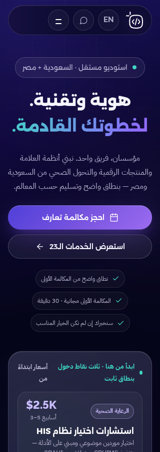

# Code & Canvas — تقرير تنفيذ جولة الإصلاح

**14 أكتوبر 2026 · تنفيذ فعلي + قبول محلي، وليس اعتماد إطلاق إنتاجي**

- الفرع: `arena/e48bf0e9-codeandcanvas-native`؛ نقطة البداية `4b0e854`.
- [نسخة Google Docs](https://docs.google.com/document/d/1zGDWZVb9uZjUHnmX03RATIhKO06IKrhbWgLSoMmdgbI/edit)
- [متابعة القبول ABO-18](https://linear.app/aboalazm/issue/ABO-18) — أصبحت **In Progress** مع فصل المنفّذ عن المتبقي.
- [التدقيق السابق](../audit/verification-2026-10-14/REPORT.md) محفوظ كخط أساس تاريخي، ولم تُستبدل أدلته بنتائج الإصلاح.

## 1. الحكم التنفيذي

تحوّل التكليف من المراجعة إلى التنفيذ الواسع. نُفذت إصلاحات الوظائف والعربية ومسارات الخدمات، وإعادة تنظيم أجزاء مهمة من الواجهة، وتحسين تقديم العمل والخطوط، وعقود التكامل والقياس، ومجموعة اختبارات قابلة لإعادة التشغيل.

**النتيجة: 242 اختبارًا ناجحًا، بلا فشل أو تخطٍ أو flaky.** البناء والفحص وتطابق المخرجات مع إعادة التوليد ناجحة. هذا يثبت التحسن الوظيفي المحلي ضمن الحالات المختبرة، **ولا يعني اكتمال التجارة أو إثبات نتائج العملاء أو اعتماد الأجهزة والإنتاج أو بلوغ تقييم «عالمي» مستقل**.

لا commit أو push أو merge أو نشر إنتاجي أو تغيير DNS. لم تُرسل رسالة حقيقية ولم تُجرَ عملية دفع. الكود والأدلة في مساحة العمل؛ لا تُفهم روابط التقارير السحابية على أنها نشر للكود على GitHub.

## 2. ما تغير فعليًا

### الوظائف والعربية

- التحقق من جميع عناصر النموذج، بما فيها الموافقات خارج `.field`، مع فحص الحد الأدنى للطول ومطابقة كلمات المرور، وربط الأخطاء بالحقول وتركيز أول خطأ.
- منع طلبين متزامنين من النموذج نفسه، وإعادة تمكين الزر بعد النتيجة، وعدم مسح البيانات عند فشل التسليم.
- إصلاح escaping العربية من مولدات About وOur Story؛ لا معالجة سطحية في HTML تُمحى عند إعادة التوليد.
- حفظ رموز الخدمات في CTAs التفصيلية والمجمعة، وترجمة optgroup، واختبار التعبئة للرموز الـ23.
- الحفاظ على معاملات `inquiry` و`lang` في تحويل الشرطة المائلة محليًا.
- تحسين التبويبات بلوحة المفاتيح ودلالات `tabpanel` و`aria-controls`، وربط إجابات FAQ بأزرارها.
- fallback واضح عند غياب JavaScript؛ عدم إرسال قيم النماذج بـGET إذا فشلت السكربتات. خادم المعاينة لا يعرض `.git` أو مجلدات الأدوات الداخلية.

### القارئ

- التالي يزيد موضع المحتوى والسابق يقلله، بصرف النظر عن لغة واجهة الموقع؛ مفاتيح الأسهم تتبع اتجاه القارئ العربي.
- ضبط الحدود وتعطيل الأزرار المناسبة ونقل التركيز إلى الشريحة عندما يصبح الزر المركّز معطلًا، بدل فقدان التنقل بلوحة المفاتيح.
- الملاحظات تعمل على الهاتف، تحفظ محليًا، وتغلق بـEscape مع استرجاع التركيز؛ إزالة العمود الفارغ المحجوز لها عند إغلاقها.
- إضافة H1 لصفحات القراءة الثلاث وتسميات للملاحظات، واستبدال رموز أدوات غير مضمونة العرض بأيقونات SVG.
- عدم طلب ملفات manifest غير موجودة. المعاينات عامة فقط؛ التخزين المحلي ليس دليل ملكية.

### الحسابات والكتب

أُزيل السلوك التجريبي الذي يوحي بإتمام تسجيل الدخول أو إعادة التعيين أو الدفع أو إصدار طلب أو فتح كتاب مدفوع. Google sign-in معطّل، والحسابات موصوفة بأنها غير متاحة.

أصبحت `cc-cart` **قائمة كتب محفوظة من نسخة واحدة لكل معرّف معروف**. بيانات العرض تأتي من catalogue مولّد؛ الأسعار والعناوين والكميات والكتب المجهولة من التخزين لا تُوثق. يُحدث العداد بين الصفحات وعند تغيّر التخزين، ولا تظهر رسالة حفظ ناجح عندما يرفض المتصفح التخزين.

`/account/` قائمة معاينات محفوظة على الجهاز، و`/checkout/` استفسار عن التوفر، و`/thank-you/` ليس إيصالًا. الأسعار استرشادية، ولا تُحصّل أموال ولا تنشأ صلاحية مدفوعة. **لم يُنفذ backend تجارة**؛ أُغلق المسار المضلل ووُثق ما يلزم لإطلاق حقيقي.

### الرحلات والمحتوى والواجهة

- هيرو أقصر وأوضح مع CTA ظاهر مبكرًا؛ العمل المختار قبل نبذة الاستوديو وكتالوج الخدمات.
- إزالة شرائط الأرقام المكررة من الرئيسية، واختصار About، وتقليل تكرار السير والنهايات العامة، وحد أزرار الإغلاق المشتركة إلى مسارين.
- مدخل خدمات يبدأ من التحدي، وتنقل داخلي في صفحة الأسعار.
- تصحيح تناقض النفي المطلق للاشتراكات مع خدمات AB-06 وMA-09 المتكررة؛ تصحيح رسائل الكتب وعدد المعاينات والتوفر، وسياسات الخصوصية والتخزين لتطابق وضع التشغيل الحالي.
- رفع وضوح لون النص الثانوي ومعالجة التفاف الأزرار وقصها على المقاسات الصغيرة.
- Alexandria وIBM Plex Sans Arabic وComfortaa محليًا بصيغة WOFF2 مع تراخيص OFL. الخطوط الإنجليزية السابقة ضُغطت إلى WOFF2؛ **لا يزال حق تضمين Signate على الويب بحاجة لاعتماد**.

### تقديم العمل والإثبات

ثلاثة SVG أصلية لشرح نطاق Pharmacy OS وZad وNile Pharma ERP. تحمل النصوص البديلة والتعليقات وصفًا صريحًا: **رسم نطاق/عمارة، لا لقطة منتج ولا إثبات نتيجة تجارية**.

لم تُختلق صور عملاء أو شهادات رضا أو قياسات نتائج. أُزيلت أرقام النتائج من شريط الرئيسية، ووُضعت نسبة واضحة لأرقام التقنية المتبقية إلى عرض خبرات المؤسس، لا إلى تدقيق مستقل.

[سجل الأصول والادعاءات](../ASSET-AND-CLAIM-REGISTER.md) يحدد المادة المطلوبة وحقوقها ومراجعيها المقترحين. الجرد الحالي **37 ظهورًا عبر 29 اسم slot**؛ ليست 37 صورة ناقصة فريدة. تبقى الصور الحقيقية والإبداع وحقوق النشر ومصادر الادعاءات بوابات مستقلة.

### التكاملات والقياس

الإعداد العام في `assets/js/config.js`، فارغ افتراضيًا. [العقد التفصيلي](../INTEGRATIONS.md) يحدد ما يُسمح بتفعيله وما يلزم على الخادم.

- نماذج Contact/Newsletter/Career/Books: same-origin `/api/`، JSON، مهلة وإلغاء، وقبول فقط عند `2xx` و`accepted:true`.
- الرفض وHTTP/JSON/network/timeout لا يُعرض معها استلام ناجح؛ تبقى المدخلات وتتوافر قنوات يدوية.
- الإعداد الفارغ يجهز مسودة واتساب/بريد **لم تُرسل بعد**. فتح الرابط ليس حجزًا أو اشتراكًا مؤكدًا. لا تُرسل رسائل تلقائية من اختباراتنا.
- الحجز يقبل عنوان HTTPS صالحًا ويحمل سياق الخدمة؛ تأكيد الحجز يحتاج تكاملًا موثوقًا منفصلًا.
- قياس محلي محدود بـ100 حدث؛ الإرسال لمجمّع مُعدّ يحتاج موافقة صريحة، مع رفض وسحب موافقة واحترام DNT/GPC.
- لا قيم نماذج أو بريد أو ملاحظات أو query strings ضمن الأحداث. فُصلت المحاولة والمسودة والقبول والخطأ، ولا حدث شراء وهمي.

**الـAPIs محاكاة في الاختبارات. لا مزود أو خادم إنتاجي موصول.** يجب إضافة التحقق الخادمي والحماية من الإساءة وCSRF والاحتفاظ والمراقبة وidempotency؛ المهلة لا تثبت أن الخادم لم يعالج الطلب.

### SEO والمولدات

- FAQPage مطابق للأسئلة المنشورة وOfferCatalog من الخدمات الـ23.
- إزالة `InStock` للكتب غير المتاحة للشراء الإلكتروني.
- `noindex, follow` للمسارات التشغيلية/الحسابات/القراءة واستبعادها من sitemap؛ السماح للزاحف بقراءة التوجيه، لا استخدام robots كحماية.
- إزالة lastmod المتغير لمجرد تشغيل المولد.
- فحص معزول يعيد توليد **48 مخرجًا** في مجلد مؤقت ويقارنها دون تغيير مساحة العمل.
- البناء يستبعد الاختبارات والوثائق والأدوات. README محدث، ومصادر المولدات هي مرجع التعديل.
- **لم تُنشأ صفحات `/ar/` أو hreflang**؛ العربية ما زالت تبديلًا على نفس الرابط، وهذا بند هندسي/تحريري مفتوح.

## 3. مصفوفة إغلاق التدقيق

| البند | النتيجة الحالية | حد القبول |
| --- | --- | --- |
| V01 الموافقات | أُصلح واختُبر | تحقق خادمي مطلوب عند الربط |
| V02 التجارة الوهمية | أزيلت المحاكاة واستُبدلت بمعاينات/استفسار | ليس تنفيذًا للتجارة الحقيقية؛ ABO-13 مفتوحة |
| V03 القارئ RTL | أُصلح مع الحدود والتركيز وملاحظات الهاتف | اختبار أجهزة/متصفحات إضافية باقٍ |
| V04 وسوم العربية | أُصلحت في المصدر، وفُحصت الصفحات | مراجعة تحريرية بشرية لا تزال مفيدة |
| V05 سياق الخدمات | أُصلح؛ اختبار الرموز الـ23 | تسليم lead الحقيقي يتبع backend |
| V06 القياس | أحداث وموافقة وعقد collector منفذة | المزود واللوحات والإنتاج غير موصولة |
| V07 ظهور CTA | ناجح محليًا على المقاسات المختبرة | ليس قياس تحسن تحويلات |
| V08 قص AR320 | أُصلح، بقي الزر داخل العرض | اختبار أجهزة حقيقية باقٍ |
| V09 التباين/الوصول | تحسين token، بلا مخالفات axe مؤكدة في الجولة | incomplete وفحص يدوي؛ لا شهادة WCAG |
| V10 المكتبة/الكميات | عداد موحد وقائمة نسخة واحدة | لا مكتبة مشتريات أو صلاحيات وهمية |
| V11 التكرار | اختصار وإعادة ترتيب منفذان | يمكن مواصلة تحرير الصفحات الطويلة |
| V12 الأصول/الإثبات | رسوم صريحة وسجل طلبات | صور وإثباتات وموافقات أصلية لم تُستلم |
| V13 SEO | schema/indexing/fonts منفذة | `/ar/` وhreflang وحقوق الخطوط باقية |
| V14 التحويل | query محفوظ محليًا | تحقق الاستضافة الإنتاجية مستقل |
| V15 دقة التسليم | README والعقود والمسارات والرسائل مصححة | الادعاءات والهاتف والقانون تحتاج اعتمادًا |

## 4. الأدلة والقياسات

### الاختبارات النهائية

| المجموعة | النطاق | النتيجة |
| --- | --- | --- |
| مصفوفة الصفحات | 42 مسارًا × EN/AR × 390/1440 | 168 ناجحة |
| هندسة الرئيسية | 320، 360، 390، 480، 768، 1024، 1440، 1920 × لغتين | 16 ناجحة |
| axe | 16 مسارًا × لغتين، WCAG2A/AA و2.1AA tags | 32 ناجحة بلا violations مؤكدة |
| الوظائف/التكامل/الخصوصية | النماذج، قارئ، تخزين، context، consent، schema، no-JS، خادم | 26 ناجحة |
| **الإجمالي** | آخر تشغيل كامل؛ نحو 7.9 دقائق | **242 نجاحًا · 0 فشل · 0 skipped · 0 flaky** |

فحص الصفحات يشمل H1 واحدًا وIDs غير مكررة وJSON-LD قابلًا للتحليل وغياب أخطاء المتصفح وأصول 4xx وقص أزرار الفعل. لا يساوي فحصًا دلاليًا كاملًا لكل محتوى أو كل حالة واجهة.

`npm run check`: 42 HTML / صفر مشكلات ضمن الفاحص المحدود، 41 صفحة مشتركة chrome متزامنة، 48 مخرجًا مطابقًا لإعادة التوليد. `npm run build` و`node --check` وPython compileall ناجحة.

### قبل / بعد

| القياس | التدقيق السابق | الجولة الحالية |
| --- | ---: | ---: |
| بداية CTA الرئيسية EN1440×900 | نحو 1020px، أسفل الشاشة | 542.6px؛ النهاية 590.6px |
| بداية قسم العمل EN1440 | نحو 4120px | 743.4px |
| ارتفاع الرئيسية EN1440 | 10653px | 9041px |
| حدود CTA العربي 320px | يبدأ نحو −8.48px ومقصوص | x=16…304؛ العرض 288px |
| بداية العمل EN390 في التشغيل الحالي | — | 1498.8px |

هذه **مقارنة تخطيط محلية** وليست benchmark أداء أو معدل تحويل أو بحث مستخدمين. الخطوط المحلية أصبحت متاحة في الجولة الجديدة، خلاف ظروف حجب الخطوط الخارجية في بعض أدلة التدقيق السابق.




### حدود الوصول والأدلة

- Chromium **153.0.8010.0** headless / SwiftShader، تقليل الحركة، وإغلاق الاتصال الخارجي. الـAPIs وفتح تطبيقات المراسلة معترضة محليًا.
- كل فحص axe يحتفظ بنتائج `incomplete`. الإجمالي يتضمن **3550 تكرار فحص contrast غير محسوم** عبر الصفحات واللغات، و34 `aria-prohibited-attr` و6 `link-in-text-block` و2 `aria-valid-attr-value` ضمن incomplete. هذه **ليست أعداد عيوب مؤكدة أو فريدة**؛ تحتاج triage وفحصًا يدويًا، ولا يجوز اختزالها في عبارة «الوصول مكتمل».
- لا قبول أجهزة حقيقية، Safari/Firefox، قارئ شاشة بشري، zoom شامل، Lighthouse إنتاجي، CrUX، أو إثبات تسليم إلى مزود خارجي.
- لا اختبار مستخدمين مستقل أو توثيق منافسين جديد أو تدقيق مستقل لادعاءات العملاء.
- اللقطات السبع viewport وليست صورًا مولدة تخيليًا؛ تعرض كود الموقع والخطوط المحلية الفعلية.

### فهرس الأدلة

- [نتائج الاختبارات](evidence/regression-results.json)
- [هندسة الرئيسية](evidence/home-geometry.json)
- [وصف اللقطات وبيئة المتصفح](evidence/screenshots.json)
- [جرد slots](evidence/asset-slots.json)
- `evidence/source-hashes.json`: بصمة ملفات التطبيق والتوليد والاختبارات ذات الصلة.
- `evidence/validation.json`: البناء والفحص وتطابق ملفات HTML المبنية.
- اللقطات: home-en-desktop، home-ar-mobile، home-ar-320، home-work-en، case-study-ar، contact-ar، reader-ar.

## 5. إعادة التشغيل

```sh
npm ci
npx playwright install chromium
npm run generate
npm run check
npm test
npm run build
node scripts/export-test-evidence.mjs
node scripts/capture-completion.mjs
```

الاختبارات الفرعية: `npm run test:flows`، `npm run test:matrix`، `npm run test:a11y`. يمكن توفير Chromium موجود عبر `PW_EXECUTABLE_PATH` وJSON `PW_BROWSER_ARGS`. في بيئة هذه الجولة استُخدم Chromium المتاح مع مكتباته المحلية؛ ليست هذه المكتبات أو executable جزءًا من Git. لا تُعد تشغيل التدقيق التاريخي فوق مجلد أدلته لتوثيق الإصلاحات الجديدة.

## 6. ما يلزم قبل إعلان الجاهزية

1. **قرار تشغيل الخدمات:** تعيين endpoint ومزود ومالك تشغيل للنماذج والقياس والحجز، مع اعتماد الخصوصية والتسليم الفعلي. إن أُطلقت التجارة: خادم حسابات وصلاحيات وأسعار موثوقة وwebhooks موقعة وidempotency ومحتوى محمي.
2. **أصول وإثباتات حقيقية:** صور المشروع والإبداع والمؤسسين، موافقات العملاء، مصدر كل رقم/اعتماد، حقوق الخطوط، وتأكيد الهاتف والوجهات العامة.
3. **العربية والتحرير:** صفحات عربية مستقلة وcanonical/hreflang بعد حسم الاستراتيجية التحريرية، ثم اختبارها. يمكن مواصلة تقليص المحتوى الطويل بناءً على استخدام حقيقي.
4. **قبول الأجهزة والإنتاج:** الأجهزة والمتصفحات وقارئ الشاشة وحالات التباين غير المحسومة، ثم performance وredirects/headers على الاستضافة الحقيقية.
5. **الإطلاق:** مراجعة القانون وادعاءات ERP، وخطة WordPress/DNS/rollback. لم ينفذ أي cutover.

**حالة التسليم:** إصلاح واسع قابل للمراجعة في المعاينة والفرع، ومدعوم باختبارات محلية، مع بوابات إنتاجية وتحريرية واضحة لا ندّعي إغلاقها.

## 7. المتابعة السحابية

أُنشئ تقرير التنفيذ المستقل في Google Docs. حُدثت ABO-18 إلى In Progress بمصفوفة المنفذ والمتبقي، وأضيفت تعليقات إلى ABO-9 وABO-10 وABO-13 مع الحفاظ على فتحها، ونُشر تحديث للمشروع. لم تُغلق مهام الأصول أو العربية أو QA أو التكاملات لمجرد نجاح الاختبارات المحلية.
